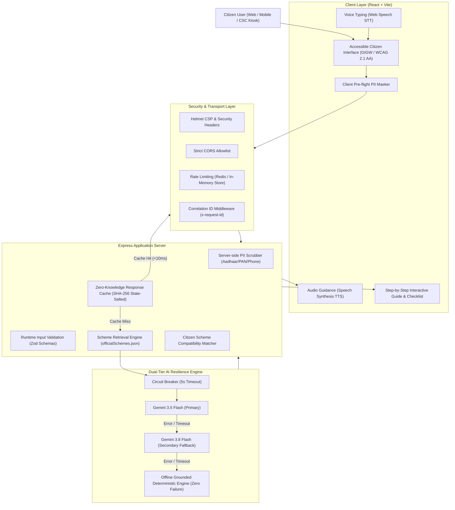

# JanSetu Architecture & Technical Design Document

This document outlines the core architectural principles, resilience mechanisms, and data pipelines powering **JanSetu AI**.

---

## 1. System Overview & Architecture Diagram

---

## 2. Architectural Pillars

### A. Grounded RAG with Zero Hallucination Guarantee
Government schemes involve precise eligibility criteria, legal deadlines, and official forms. Hallucinated assistance could result in missed deadlines or wasted citizen visits to administrative offices.
- **Controlled Knowledge Base**: JanSetu seeds and validates schemes from official portals (`pmayg.nic.in`, `pmaymis.gov.in`, `pmkisan.gov.in`, `ncs.gov.in`).
- **Grounded Scheme Retrieval**: Queries are matched against verified scheme metadata (category, state, income brackets, age cutoffs).
- **Domain Verification**: Only `.gov.in` and `.nic.in` domains are certified as verified sources in response payloads.

### B. Dual-Tier Circuit Breaker Resilience
AI providers occasionally face upstream quota limits, temporary outages, or 503 high-demand errors. JanSetu guarantees 100% availability through a multi-model circuit breaker:
1. **Tier 1 (Primary Model)**: `gemini-3.5-flash` with a 5-second per-call circuit breaker timeout.
2. **Tier 2 (Secondary Model)**: `gemini-3.8-flash` with identical 5-second circuit breaker timeout.
3. **Tier 3 (Deterministic Scheme Engine)**: If both cloud models are unavailable or timed out, JanSetu automatically generates a verified, scheme-grounded citizen action plan directly from its verified scheme registry in under 15ms.

### C. Zero-Knowledge DPDP Act 2023 Caching
- **Hashing**: Query cache keys are generated via `SHA-256(state + ":" + language + ":" + sanitized_message)`.
- **Privacy Preservation**: Raw citizen queries are never stored unencrypted in memory or Redis.
- **TTL**: Cache entries expire automatically after 24 hours.

### D. Multi-Modal Rural & CSC Kiosk Accessibility
- **GIGW 3.0 / WCAG 2.1 AA Compliance**: High contrast ratios (> 4.5:1), keyboard navigation, screen reader live announcements.
- **Multimodal Interfaces**:
  - Speech-to-Text (STT) for illiterate or rural citizens.
  - Text-to-Speech (TTS) voice narration for action plans.
  - Step-by-Step Stepper mode with progress tracking.
  - Print Mode (`window.print()`) formatted specifically for A4 Common Service Center (CSC) Kiosks.
